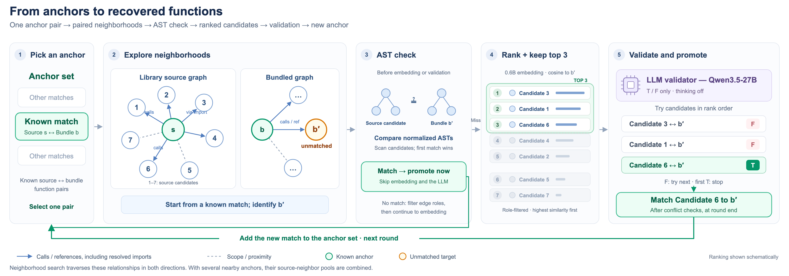
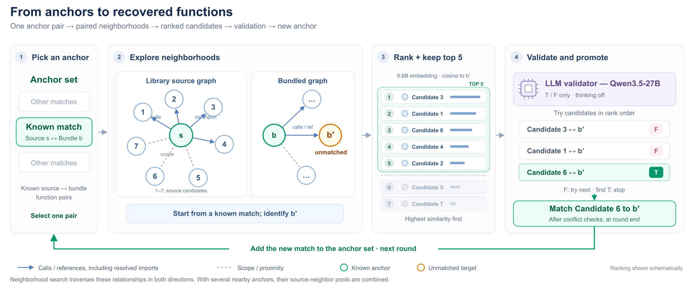

<p align="center">
  
</p>
<h1 align="center">ReCall</h1>
<p align="center"><strong>Recover library functions from bundled JavaScript.</strong></p>
<p align="center">POG anchors · AST-first matching · relationship-aware search · model validation</p>
<p align="center">
  <a href="package.json"></a>
  <a href="docs/configuration.md"></a>
  <a href="#how-it-works"></a>
</p>
<p align="center">
  <a href="#quick-start">Quick start</a> ·
  <a href="#how-it-works">How it works</a> ·
  <a href="#usage">Usage</a> ·
  <a href="#outputs">Outputs</a> ·
  <a href="#documentation">Documentation</a>
</p>

---

ReCall links functions in supplied production bundles to their original library implementations. It uses inexpensive structural matches first, then spends embedding and validator requests on candidates supported by corresponding graph relationships.

- **AST before embeddings.** The first AST shape match is promoted immediately, with no embedding or validator request for that target search.
- **Relationship-aware candidates.** After an AST miss, require matching edge kinds and directions around an accepted pair before ranking candidates.
- **Explicit analysis boundaries.** Source relationships stay inside a library instance; bundle relationships can cross supplied chunks. Recovery consumes no source maps or GT labels.
- **Inspectable execution.** Save inputs, graphs, predictions, diagnostics, resolved configuration and resumable checkpoints.

## How it works

[](docs/assets/pipeline-workflow-current.svg)

1. **Prepare inputs and anchors.** Preserve original function identities and spans, extract POG fingerprints, and resolve source and bundle relationships.
2. **Explore paired neighborhoods.** For an unmatched bundled function, gather radius-one source candidates around accepted correspondences.
3. **Try AST matching first.** Scan the candidate pool in order. The first matching normalized AST is accepted immediately and can seed later targets in the same pass.
4. **Filter after an AST miss.** Retain candidates with at least one accepted parent pair supporting the same edge kind and direction. An empty pool needs no model request.
5. **Embed and validate.** Rank surviving candidates by cosine similarity and validate up to **three**, stopping at the first acceptance. Model-accepted proposals are promoted after conflict checks at round end.
6. **Repeat.** Continue propagation until a fixed point or configured budget limit.

AST matching is a heuristic: identical bodies and renamed external bindings can hide different original identities. Relationship filtering can also exclude valid pairs when transformations change graph structure. See [configuration and limitations](docs/configuration.md).

<details>
<summary>Original workflow artwork</summary>

The original illustration is restored unchanged. It documents the earlier top-five workflow; the diagram above describes the current AST-first, top-three implementation.



</details>

## Quick start

Requires **Node.js 24+**, npm, and an Ollama-compatible service for model recovery.

```sh
npm ci
node bin/recall.mjs recover examples/minimal/bundle \
  --references examples/minimal/source \
  --config examples/minimal/config.json \
  --prepare-only --out outputs/demo
```

Preparation parses inputs, extracts features, and builds graphs without model calls. The example produces one POG anchor. Continue with the configured models:

```sh
node bin/recall.mjs recover examples/minimal/bundle \
  --references examples/minimal/source \
  --config examples/minimal/config.json \
  --resume --out outputs/demo
```

Use a new output directory after changing implementation, inputs, or model settings. Preserve existing results for reproducibility.

## Usage

### Supplied source and bundle manifests

```sh
node bin/recall.mjs run \
  --source-manifest /path/to/source.json \
  --bundle-manifest /path/to/bundle.json \
  --config examples/known-reference.config.json \
  --out outputs/experiment
```

Use the same source bytes, original function spans, package identities and supplied chunks as the intended experiment. Different source representations can produce different identities even when the code behaves similarly.

### Default behavior

| Setting | Default |
|---|---|
| Embedding | `qwen3-embedding:0.6b` |
| Validation | `qwen3.5:27b`, thinking off |
| Endpoint | `http://127.0.0.1:11434` |
| Library identification gate | Disabled |
| Initial anchors | POG equality, at least 10 property operations |
| AST precheck | Before embeddings; first matching candidate accepted |
| Relationship filter | Same edge kind and direction after an AST miss |
| Ranked validation | Top 3; stop at first acceptance |
| Neighborhood radius | 1 |
| Bundle cross-chunk relationships | Enabled across supplied files |
| Source relationships | Isolated per library instance |

Simulation in **ReCall Exp** retains real embeddings and substitutes GT decisions only for model validation. Ordinary ReCall uses real validation; matching settings do not guarantee simulation scores. AST equality is a heuristic, not proof of unique origin.

Relationship-aware pruning is enabled by default; the old unfiltered path is removed. See [fast-validation.config.json](examples/fast-validation.config.json) and the [configuration tradeoffs](docs/configuration.md#relationship-pruning-before-model-validation).

Enable `recovery.libraryGate:true` explicitly to require the library anchor threshold. Catalog discovery independently applies its identification threshold. Neither option relaxes source isolation.

## Development

### Code organization

| Location | Responsibility |
|---|---|
| `bin/` | CLI |
| `components/` | Public capture, POG, bundler, module, graph and recovery APIs |
| `src/config.mjs` | Canonical defaults and configuration validation |
| `src/workflow/` | Input preparation, preflight, orchestration and outputs |
| `src/analysis/` | Parsing, TypeScript, scopes, AST comparison and neighborhoods |
| `src/engine/` | Bundler adapters and module/value-flow solver |
| `src/shared/` | Artifact contracts, hashes and common utilities |
| `test/` | Current implementation regression and integration tests |
| `benchmarks/` | Offline performance checks on saved artifacts |
| `examples/` | Runnable inputs and supported configurations |
| `vendor/`, `third_party/` | Required fingerprint dependencies and notices |

Historical scripts and obsolete validation records live outside the runtime repository. Generated outputs, caches and node_modules are Git-ignored; existing local experiment outputs are preserved.

Source resolution does not follow inter-library calls. Bundle resolution can follow cross-module and cross-chunk relationships among supplied files. ReCall does not automatically discover every runtime-loaded chunk. Use the [optional capture workflow](docs/capture-workflow.md) to prepare browser captures.

## Outputs

Runs save resolved configuration, inventories, anchors, module maps, graphs, recovery decisions and status under the requested output directory. Inspect `status.json`, `resolved-config.json` and `recovery.json`. Promotions are predictions; recovery rate requires separate ground-truth evaluation.

The validator prompt is [validator-system-prompt.txt](src/analysis/validator-system-prompt.txt). Requests and digest-keyed caches are implemented in [models.mjs](components/pipeline/models.mjs).

## Tests

```sh
npm test
```

Tests cover parsing, library isolation, module resolution, relationship pruning, AST-first matching, model integration and checkpoint resume. They use synthetic fixtures and mock HTTP services, not real model inference; integration tests require localhost socket access.

## Documentation

- [Input preparation and CLI workflow](docs/quickstart.md)
- [Configuration](docs/configuration.md)
- [Component APIs and artifact contracts](docs/component-contracts.md)
- [Adapter development](docs/adapters.md)
- [Performance notes](docs/performance.md)
- [Troubleshooting](docs/troubleshooting.md)
- [Migration](docs/migration-0.3.md)
- [Optional capture](docs/capture-workflow.md)
- [Minimal example](examples/minimal/README.md)

Public JavaScript exports are in [index.mjs](index.mjs); each component has its own README and package export.

## Research and provenance

**ReCall Dataset** owns ground truth and dataset membership. **ReCall Exp** owns evaluation runners, the GT-based simulation validator, reports and historical implementation snapshots. Keep experimental outcomes separate from normal recovery predictions.

The [visual asset guide](docs/assets/README.md) identifies the current workflow, restored original artwork and tool icons. Third-party fingerprint implementations and their notices remain under `vendor/` and `third_party/`.
