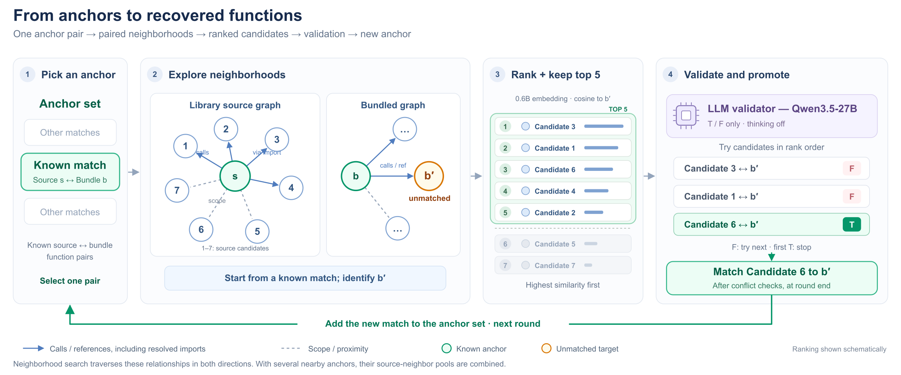
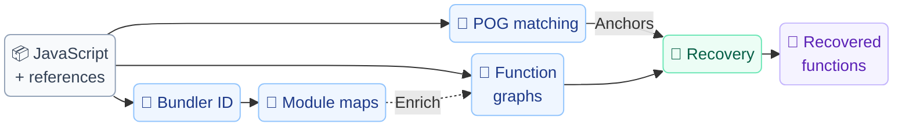

<h1 align="center">ReCall</h1>

<p align="center">
  <strong>Accurate and Scalable Function Recovery for Bundled JavaScript</strong>
</p>

<p align="center">
  Connect functions in captured JavaScript to their original library implementations.
</p>

<p align="center">
  <a href="#quick-start">Quick start</a> ·
  <a href="#how-it-works">How it works</a> ·
  <a href="#usage">Usage</a> ·
  <a href="#outputs">Outputs</a> ·
  <a href="#components">Components</a> ·
  <a href="#documentation">Documentation</a>
</p>

---

ReCall recovers library function identities from bundled JavaScript using **POG anchors**, **module-aware relationship graphs**, and **LLM validation**. Give it captured JavaScript and local library references—or a fingerprint catalog—and receive a function mapping with locations, package versions, and recovery evidence.

- **Anchor-guided recovery.** Start from fingerprint matches and expand through corresponding source and bundle neighborhoods.
- **Bundler-aware analysis.** Resolve mechanisms used by webpack, Rspack, esbuild, Rollup, Rolldown, Turbopack, and Parcel.
- **Configurable inference.** Choose ranking and validation models, candidate limits, graph settings, and budgets.
- **Inspectable runs.** Save intermediate artifacts, inspect decisions, and resume compatible checkpoints.

## Quick start

You need **Node.js and npm**. Run the following from this checkout:

```sh
npm ci

node bin/recall.mjs recover examples/minimal/bundle \
  --references examples/minimal/source \
  --config examples/minimal/config.json \
  --prepare-only \
  --out outputs/demo
```

This prepares the example **without a model service**. Open `outputs/demo/anchors.json`, `libraries.json`, and `sourceGraph.json` / `bundleGraph.json` to inspect the static results. The example uses a library threshold of one to demonstrate a small imported-helper case.

<details>
<summary><strong>Continue the example with model validation</strong></summary>

Make the configured models available on an Ollama-compatible service, then continue the prepared run:

```sh
node bin/recall.mjs recover examples/minimal/bundle \
  --references examples/minimal/source \
  --config examples/minimal/config.json \
  --resume \
  --out outputs/demo
```

| Role | Default model |
|---|---|
| Candidate ranking | `qwen3-embedding:0.6b` |
| Function-pair validation | `qwen3.5:27b` |

Validation uses thinking off and strict **T/F** responses. The default endpoint is `http://127.0.0.1:11434`. Model names and serving options can be changed in your [configuration](docs/configuration.md); model weights are managed by the serving runtime.

</details>

## How it works

[](docs/assets/pipeline-workflow-b-prime.png)

A known match between a source function **s** and bundled function **b** provides the starting anchor. ReCall finds an unmatched neighbor **b′**, collects source candidates from the corresponding neighborhoods, and ranks them by embedding similarity. The **top five** are validated in order; the first positive proposal can become a new anchor after conflict checks at round end.

Solid graph arrows represent calls or function references, including resolved imports; dashed edges represent scope or proximity. Search traverses these relationships in both directions and combines candidate pools from nearby anchors. The figure illustrates the process rather than experimental scores. [Open full-size figure](docs/assets/pipeline-workflow-b-prime.png) · [Editable SVG](docs/assets/pipeline-workflow.svg)

## Usage

### Recover from your own JavaScript

Put captured `.js`, `.mjs`, and `.cjs` files in a directory. Supply local reference packages, each with a `package.json` identifying its name and version. Copy the starter configuration and run:

```sh
cp examples/recall.config.json recall.json

node bin/recall.mjs recover ./captured-js \
  --references ./reference-packages \
  --config recall.json \
  --out outputs/site
```

Adjust the model endpoint and aliases in `recall.json` for your serving environment. Use an [explicit manifest](components/pog/README.md#manifest-and-contracts) when you need to curate input files or separate execution environments. Browser capture is performed before running ReCall.

<details>
<summary><strong>Identify libraries using a fingerprint catalog</strong></summary>

Build a reusable catalog from your reference packages, then use it to identify library/version candidates in captured code:

```sh
node bin/recall.mjs catalog build \
  --references ./reference-packages \
  --out outputs/library-catalog.json

node bin/recall.mjs recover ./captured-js \
  --catalog outputs/library-catalog.json \
  --config recall.json \
  --out outputs/catalog-run
```

ReCall uses verified local references when available and otherwise obtains exact npm versions with archive integrity checks. Package scripts are not executed. The catalog covers the packages and versions you indexed; a comprehensive npm catalog is not bundled. Ambiguous library versions remain explicit. See the [catalog guide](docs/quickstart.md#build-and-reuse-a-library-catalog).

</details>

### Check, resume, and control runs

Check inputs, configuration, and model availability before recovery:

```sh
node bin/recall.mjs preflight ./captured-js \
  --references ./reference-packages \
  --config recall.json
```

| Option | Behavior |
|---|---|
| `--prepare-only` | Prepare static artifacts without model inference; preflight skips model checks |
| `--resume` | Continue the same run using compatible artifacts and checkpoints |
| `--offline` | Require valid local or cached package references |
| `--quiet` | Suppress progress messages |

Add `--resume` to the original recovery command to continue its output directory. Changed inputs, model identity, tool code, or analysis settings require a new run; validation and round budgets may be increased. See [configuration](docs/configuration.md) for all parameters and [troubleshooting](docs/troubleshooting.md) for common failures.

```sh
node bin/recall.mjs recover --help
```

## Outputs

Each run writes its artifacts to the chosen output directory:

```text
outputs/site/
├── recovered-functions.json   # Bundled locations → library function identities
├── summary.json               # Coverage, counts, unresolved categories
├── recovery.json              # Rankings, verdicts, and promotion evidence
├── resolved-config.json       # Applied defaults and overrides
├── checkpoint.json            # Continuation state
└── …                          # Inventories, anchors, module maps, and graphs
```

The main mapping includes the library name/version, source and bundle locations, and recovery method. Use it directly in downstream analysis:

```js
import fs from 'node:fs';

const {functions} = JSON.parse(
  fs.readFileSync('outputs/site/recovered-functions.json', 'utf8')
);

for (const match of functions) {
  console.log(match.bundle.file, match.bundle.span,
              match.source.library, match.source.name, match.method);
}
```

**Recovery coverage is not accuracy.** Coverage counts recovered functions among parsed input functions; parse failures are reported separately. Accuracy requires independent ground truth. Static preparation stops before producing the final recovery mapping and summary.

## Components

The five components have standalone commands and JavaScript APIs. They exchange versioned JSON artifacts and share one configuration format.

| Component | Purpose | Guide |
|---|---|---|
| POG features and identification | Generate fingerprints, anchors, and library/version evidence | [POG](components/pog/README.md) |
| Bundler identifier | Collect structural evidence and candidate bundler families | [Bundler](components/bundler/README.md) |
| Module-map resolver | Resolve imports, exports, bindings, and chunk relationships | [Modules](components/modules/README.md) |
| Relationship graph builder | Construct source and bundle candidate neighborhoods | [Graphs](components/graph/README.md) |
| Recovery pipeline | Rank, validate, and promote neighboring candidates | [Pipeline](components/pipeline/README.md) |

<details>
<summary><strong>View component relationships</strong></summary>



Module maps optionally enrich the source and bundle graphs; graph construction can also use local syntax alone. Bundler evidence may be ambiguous, so resolution follows the mechanisms found in the code. In catalog mode, bundled POG fingerprints first select library/version candidates before their references are obtained.

</details>

## Documentation

| I want to… | Read |
|---|---|
| Prepare real inputs and run recovery | [Quickstart](docs/quickstart.md) |
| Change models, thresholds, or graph settings | [Configuration reference](docs/configuration.md) |
| Integrate components and inspect artifacts | [Data contracts](docs/component-contracts.md) |
| Add support for another runtime format | [Adapter development](docs/adapters.md) |
| Diagnose a failed or incomplete run | [Troubleshooting](docs/troubleshooting.md) |
| Update an earlier component setup | [Migration guide](docs/migration-0.3.md) |

## Development and research

```sh
npm test
```

Tests use synthetic fixtures and mock model/registry services, without real model inference. The [validation record](docs/component-validation.json) includes a real-repository connectivity check against recorded experiment results. Oracle-assisted simulation is an explicit experiment mode and is separate from normal model recovery.

This repository contains the reusable tool. The sibling **ReCall Exp** and **ReCall Dataset** repositories hold experiments/paper materials and datasets; neither is required to run the public components. Historical scripts and recorded evidence are preserved for reproducibility. Dependency provenance is documented under `vendor/debun` and [third_party](third_party/README.md).
